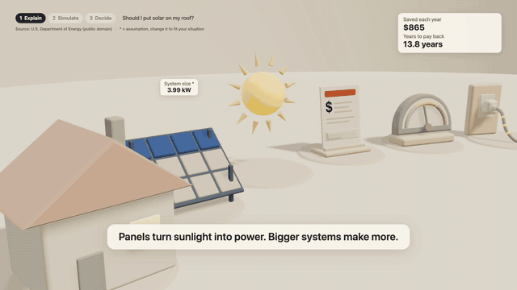
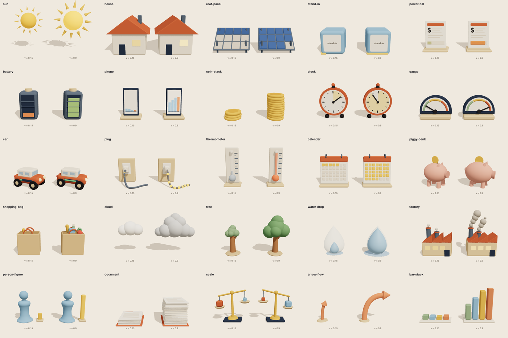

# Explain, Simulate, Decide

**Don't read the report. Run the model.**

Turn an article into a small **living world** that explains it, in three acts:

1. **Explain.** A directed film shows the system working. The sun lands on the panels, power flows into the home and out to the grid, and coins stream into a savings jar. The number of particles in each stream is its rate, so a trickle next to a stream needs no caption.
2. **Simulate.** The page asks about *your* situation: your bill, your state, your habits, the option you lean toward. Then it runs the same world with your numbers. Drag things in the scene, move the sliders, and run the clock for 25 years.
3. **Decide.** The camera steps back and compares your options side by side with your numbers. It lists the trade-offs, what the model leaves out, and questions to ask. The page never tells you what to choose.

The output is **one offline HTML file**. It can also record itself to a **1080p 60 fps MP4** with a generated music bed.



*Demo: "Should I put solar on my roof?", built from the U.S. Department of Energy's homeowner guides (public domain). [Open the interactive page](examples/solar/solar.html).*

---

## Why

Spreadsheets didn't replace accountants. They moved them from calculating to modelling. AI can do the same for anyone who reads: move people from reading reports to running models. When building is cheap, clarity, honest models and craft are what matter. This project tries to make that easy and reusable.

## Three ways to use it

### 1. As a Claude Code skill

```bash
/plugin marketplace add anudeepc/explain-simulate-decide
/plugin install explain-simulate-decide@explain-simulate-decide
```

Or copy `skills/explain-simulate-decide/` into `~/.claude/skills/`. Then ask:

> Explain this article as an interactive explainer: https://…

The skill thinks the topic through before it draws anything:

- It asks you up to three questions that change the answer, such as where you live, your average monthly bill, and whether you'd send spare power to the grid or store it in a battery.
- It looks up current local figures (install cost, power prices, export credits) and quotes each one word for word with its source and the date it was read.
- It picks the story's **shape**: something building up, a loop that feeds itself, a fixed amount being shared, one thing turning into another, a cause and its effect, a risk out of 100 people, or a process with no numbers at all. Each shape gets a different world, so a sleep article, a credit card article and an article on how a law is passed all look right.
- It maps the topic as a system: what flows where, what builds up over time, and what pushes on what.
- It writes down what the article says the answer should look like, and the validator runs the model against it.

It then writes a screenplay, validates it, renders the page, and checks its own work against a list (every number sourced, Decide never recommends).

### 2. The free web tool, with your own key

Open the [GitHub Pages site](https://anudeepc.github.io/explain-simulate-decide/web/) and:

1. Paste the article, or upload a PDF.
2. Pick a provider: Claude, OpenAI, OpenRouter (which has free models), Groq, local **Ollama**, or any OpenAI-compatible API.
3. Generate. Then **Download HTML**, **Record MP4** or **Download screenplay**.

There is no server. Your article and key go only to the provider you choose. Pick **Demo** to try it without a key.

### 3. From the command line

```bash
node skills/explain-simulate-decide/scripts/validate.mjs my-screenplay.json
node skills/explain-simulate-decide/scripts/render.mjs my-screenplay.json -o explainer.html
```

This needs Node 18 or later. No packages to install.

## How it works

```
article ──► AI writes a screenplay (JSON) ──► validator ──► fixed renderer ──► film + model + decision
              question, levers, model,         plain-English    staging, camera,
              cast, shots, decide notes        errors           timing, motion
```

The screenplay describes a **system** with a **shape** (`build-up`, `feedback`, `budget`, `conversion`, `cause`, `chances` or `process`):

- **Nodes:** the characters. Each is a studio prop (a house, panels, the grid, a jar, a crowd of 100 people, a body, a building…) or just a *kind* (person, institution, land, medicine…), and the renderer picks the look.
- **Flows:** energy, money, water, heat, time, carbon, substances, and influences (one thing pushing on another), each with a rate formula and a unit.
- **Stores:** amounts that build up over a clock, such as savings, water in a tank or sleep debt, with **milestones** like "paid back in 20.6 years".
- **Checks:** what the source says the answer looks like ("pays back in 6 to 12 years", "more screens, less sleep").
- **Questions** the page asks the viewer, and **options** to compare.

A `process` story (how a vaccine works, how a bill becomes law) has no numbers: it gets the film and Decide, and no invented model.

The key design choice is that **the AI writes only the screenplay, never the film.** All the directing lives in code:

- **Consistent quality.** Every film follows the same directing rules (staging, camera speed, easing, reading-time pacing), whatever model wrote the screenplay.
- **Small and free models work.** They only fill in structured content.
- **Safety.** No AI-written code ever runs. Formulas go through a tiny arithmetic parser (no `eval`), captions are shown as plain text, and exported pages carry a strict Content-Security-Policy.
- **Honesty is enforced.** Every number is either quoted from the article or labelled an assumption, and the validator checks this.
- **Wrong maths is caught.** Every value has a unit, and the validator checks that every formula comes out in it, so a missing × 365, a percent not divided by 100, or kWh added to dollars is rejected. It runs the model against the source's own figures and directions, and tries every extreme of the inputs: values must stay numbers, and flows can't run backwards.

### The director's rules

| Shot | Camera | What happens |
|---|---|---|
| `establish` | Wide, slow arc | The whole world, running; the question appears |
| `follow` | Rides alongside a flow | Where the energy or money actually goes |
| `cause` | Two-shot of a flow's ends | An input sweeps and the stream thickens and thins |
| `turn` | Slow arc, longest shot | The common misconception, made visible (two streams side by side) |
| `timelapse` | Medium on a store | The clock runs; the jar fills, crosses its line, a flag rises |
| `handoff` | Settles to the simulation view | "Make it yours" questions appear |

Only one thing moves at a time, and nothing moves unless it explains something. Shot length follows reading time. Camera moves become cuts when the viewer has turned on "reduce motion".

### The props

There are 28 studio props in one matte clay style, all everyday objects: a house with a roof slot for panels, a power pole, a bank, a glass jar that fills with coins, a battery, a sun, a cloud, and more. A prop can show a value, and in Simulate you can drag it to change that value.



The **Cast** setting chooses where props come from:

- **Studio:** the built-in clay props above.
- **Open library:** free CC0 glTF models, with credits added automatically.
- **Custom-built:** simple shapes the AI describes as data.

Any prop that can't be built falls back in this order: studio, then custom, then a labelled stand-in block. Every article renders.

## Repository layout

```
skills/explain-simulate-decide/
  SKILL.md                 the skill (short; details in references/)
  references/              extraction guide, system guide, screenplay format, shot types, writing rules, prop catalog
  scripts/                 validate.mjs, render.mjs
  engine/                  the renderer: plain ES modules, three.js vendored, no build step
web/                       the free upload tool (static, GitHub Pages)
examples/solar/            the demo: sourced figures, five states, battery option
examples/heat-pump/        a second world: gas furnace vs heat pump
tests/                     node --test unit tests + browser checks (Playwright)
```

## Development

```bash
npm test                    # unit tests: formulas, units, model, schema, timing, coverage, export
npm run render:solar        # rebuild the demo page
npm install && npm run check            # browser render check (needs Playwright's Chromium)
node tests/cast-check.mjs               # every prop and every character kind builds and renders
node tests/audio-sync-check.mjs         # the picture keeps time with the music, even on slow machines
npm run render:examples                 # rebuild example pages after any engine change (a test fails until you do)
node tests/web-check.mjs                # web tool with a fake AI provider (repairs, made-up quotes)
node tests/record-mp4.mjs examples/solar/solar.html out.mp4 --size 1280x720 --fps 30
python3 -m http.server 8080 # then open http://localhost:8080/web/
```

**Add a prop:**

1. Create `skills/explain-simulate-decide/engine/cast/<name>.js`, exporting `build(ctx) → { object, height, setValue(v) }`.
2. Register it in `cast/index.js` and `cast/names.js`.
3. Add a row to `references/prop-catalog.md`.
4. Run `node tests/cast-check.mjs` and look at `test-results/cast-sheet.png`.

**Coverage.** `tests/coverage.test.mjs` fails if any story shape, carrier or shot type is used by no screenplay in the repo, or any character kind has no look. Add a fixture when you add one. The cross-topic test set in `tests/fixtures/eval` shows how the skill handles eight different fields.

## Content principles

- More understanding, not more engagement.
- Plain words. Captions are 12 words or fewer.
- Every number sourced or labelled.
- The page explains and the person decides. No recommendations, no persuasion, no urgency.

## Licence

MIT. three.js, mp4-muxer and pdf.js are vendored under their own MIT/Apache licences (see `engine/vendor/README.md` and `web/vendor/pdfjs/LICENSE`). The demo uses public-domain text from the U.S. Department of Energy.
